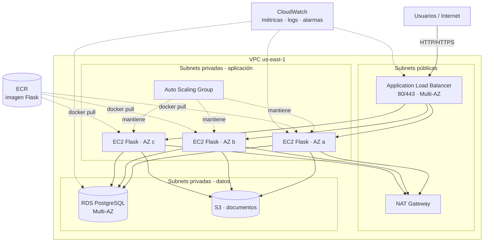

# Diagrama de arquitectura — Workshop 6

Pega el bloque de Mermaid en <https://mermaid.live>, revisa que renderice bien y
exporta una imagen PNG para guardarla en `04/06/capturas/01-arquitectura.png`.

## Lectura del diagrama

- **Público:** solo el ALB (80/443) y el NAT Gateway para salida a Internet.
- **Privado:** las EC2 de Flask, RDS, S3 (acceso por IAM) y ECR.
- **Escalable:** ALB, Auto Scaling Group y las réplicas de Flask.
- **Persistente:** RDS Multi-AZ, S3 con versioning y ECR con imágenes versionadas.
- **Monitoreado:** CloudWatch (métricas, logs y alarmas), access logs del ALB,
  X-Ray/ADOT y GuardDuty/Security Hub.
- **Seguridad:** subnets privadas, Security Groups encadenados, IAM Roles,
  Secrets Manager, TLS/ACM y WAF.
